<p align="center">
  <a href="https://ankitsatnami.github.io/Robotic_arm_simulator/">
    
  </a>
</p>

# Fanuc Cobot Kinematics Playground
### A Real-Time 6-DOF Robotic Arm Simulation & Kinematics Research Platform

[](https://ankitsatnami.github.io/Robotic_arm_simulator/)
[](https://ankitsatnami.github.io/Robotic_arm_simulator/)
[](https://github.com/Ankitsatnami)
[](LICENSE)

---

## 🔬 Project Overview & Abstract

**Fanuc Cobot Kinematics Playground** is an interactive, browser-based 3D robotics simulation and kinematics verification platform developed by **Ankit Satnami**. The platform implements rigorous forward kinematics (FK), closed-form analytical inverse kinematics (IK) yielding all 8 distinct geometric configurations, differential kinematics via a real-time $6 \times 6$ geometric Jacobian, singularity diagnostics, trajectory interpolation (MOVEJ and MOVEL), and multi-platform controller code synthesis.

Designed as an open-access research and educational testbed, the platform provides real-time visualization of Denavit-Hartenberg (DH) coordinate transformations, Yoshikawa manipulability indices, and physical robot workspace envelopes.

- **Primary Live Deployment**: [https://ankitsatnami.github.io/Robotic_arm_simulator/](https://ankitsatnami.github.io/Robotic_arm_simulator/)
- **Mirror Deployment**: [https://bubbly-part-x4033.ship.place/](https://bubbly-part-x4033.ship.place/) (Backup: [https://eight-kitchen-mngsz.ship.place/](https://eight-kitchen-mngsz.ship.place/))
- **GitHub Repository**: [https://github.com/Ankitsatnami/Robotic_arm_simulator](https://github.com/Ankitsatnami/Robotic_arm_simulator)
- **Principal Author**: [Ankit Satnami](https://github.com/Ankitsatnami)

---

## 📐 Mathematical & Kinematic Formulations

### 1. Forward Kinematics (Denavit-Hartenberg Formulation)
For each joint link $i \in \{1, \dots, 6\}$, the relative spatial transformation between coordinate frame $\{i-1\}$ and frame $\{i\}$ is described by the standard Denavit-Hartenberg (DH) homogeneous transformation matrix $A_i \in \mathrm{SE}(3)$:

$$
A_i = \mathrm{Rot}_{z}(\theta_i) \cdot \mathrm{Trans}_{z}(d_i) \cdot \mathrm{Trans}_{x}(a_i) \cdot \mathrm{Rot}_{x}(\alpha_i)
$$

$$
A_i = \begin{bmatrix}
\cos\theta_i & -\sin\theta_i \cos\alpha_i & \sin\theta_i \sin\alpha_i & a_i \cos\theta_i \\
\sin\theta_i & \cos\theta_i \cos\alpha_i & -\cos\theta_i \sin\alpha_i & a_i \sin\theta_i \\
0 & \sin\alpha_i & \cos\alpha_i & d_i \\
0 & 0 & 0 & 1
\end{bmatrix}
$$

The cumulative end-effector pose $T_0^6$ relative to the base coordinate frame is computed through chained post-multiplication:

$$
T_0^6 = \prod_{i=1}^{6} A_i(\theta_i) = A_1(\theta_1) \cdot A_2(\theta_2) \cdot A_3(\theta_3) \cdot A_4(\theta_4) \cdot A_5(\theta_5) \cdot A_6(\theta_6) = \begin{bmatrix}
R_{3 \times 3} & \mathbf{p}_{3 \times 1} \\
\mathbf{0}_{1 \times 3} & 1
\end{bmatrix}
$$

where:
- $R_{3 \times 3} \in \mathrm{SO}(3)$ represents the end-effector orientation matrix, parameterized into FANUC standard Euler Yaw-Pitch-Roll ($W$-$P$-$R$) angles: $R = R_z(W) \cdot R_y(P) \cdot R_x(R)$ (Yaw $W$ about $Z$, Pitch $P$ about $Y$, Roll $R$ about $X$).
- $\mathbf{p} = [X, Y, Z]^T$ represents the Cartesian Tool Center Point (TCP) position in millimeters.

---

### 2. Analytical Inverse Kinematics (Pieper's Decoupling Criterion)
For 6-DOF industrial manipulators featuring a spherical wrist where axes 4, 5, and 6 intersect at a common point (the wrist center $\mathbf{p}_w$), the inverse kinematics problem decouples analytically into two independent sub-problems:

1. **Position Decoupling (Wrist Center $\mathbf{p}_w$)**:
   The wrist center coordinates are isolated by translating backwards along the tool approach vector $\mathbf{a} = R_{0}^6 \hat{\mathbf{z}} = [R_{13}, R_{23}, R_{33}]^T$ by the tool flange offset distance $d_6$:
   $$\mathbf{p}_w = \mathbf{p} - d_6 \mathbf{a} = \mathbf{p} - d_6 R \begin{bmatrix} 0 \\ 0 \\ 1 \end{bmatrix}$$
   With $\mathbf{p}_w = [x_w, y_w, z_w]^T$ determined, joint angles $\theta_1, \theta_2, \theta_3$ are solved geometrically using planar trigonometry and the law of cosines.

2. **Orientation Decoupling (Spherical Wrist $\theta_4, \theta_5, \theta_6$)**:
   Given $\theta_1, \theta_2, \theta_3$, the intermediate rotation matrix $R_0^3$ is evaluated. The relative wrist rotation matrix $R_3^6$ is then isolated:
   $$R_3^6 = (R_0^3)^T R$$
   The spherical wrist angles $\theta_4, \theta_5, \theta_6$ are derived analytically via standard Euler Z-Y-Z matrix factorisation:
   $$\theta_5 = \pm \arccos\left(R_{33}^{3\to6}\right)$$
   $$\theta_4 = \mathrm{atan2}\left(\frac{R_{23}^{3\to6}}{\sin\theta_5}, \frac{R_{13}^{3\to6}}{\sin\theta_5}\right), \quad \theta_6 = \mathrm{atan2}\left(\frac{R_{32}^{3\to6}}{\sin\theta_5}, -\frac{R_{31}^{3\to6}}{\sin\theta_5}\right)$$

#### The 8 Closed-Form Kinematic Configurations:
FANUC industrial controllers designate kinematic postures using the configuration string format:
`[Wrist] [Elbow] [Shoulder], Turn_J4, Turn_J5, Turn_J6` (e.g. `N D T, 0, 0, 0`). The 8 distinct analytical branch solutions are categorized as:

| Configuration Code `[W E S]` | Wrist ($J_5$): Flip / Non-Flip | Elbow ($J_3$): Up / Down | Shoulder / Arm ($J_1 / J_2$): Top / Bottom | Description |
|:---:|:---:|:---:|:---:|---|
| **N D T, 0, 0, 0** | Non-flip ($\theta_5 \ge 0^\circ$) | Down ($\theta_3 < 0^\circ$) | Top / Front ($\theta_1 \in [-\pi/2, \pi/2]$) | **Nominal FANUC CRX-10iA pose** (standard forward reach) |
| **F D T, 0, 0, 0** | Flip ($\theta_5 < 0^\circ$) | Down ($\theta_3 < 0^\circ$) | Top / Front ($\theta_1 \in [-\pi/2, \pi/2]$) | Forward reach with inverted wrist pitch ($\pm 180^\circ$ roll flip) |
| **N U T, 0, 0, 0** | Non-flip ($\theta_5 \ge 0^\circ$) | Up ($\theta_3 \ge 0^\circ$) | Top / Front ($\theta_1 \in [-\pi/2, \pi/2]$) | Overhead reach, elbow arched up, standard wrist |
| **F U T, 0, 0, 0** | Flip ($\theta_5 < 0^\circ$) | Up ($\theta_3 \ge 0^\circ$) | Top / Front ($\theta_1 \in [-\pi/2, \pi/2]$) | Overhead reach, elbow arched up, flipped wrist |
| **N U B, 0, 0, 0** | Non-flip ($\theta_5 \ge 0^\circ$) | Up ($\theta_3 \ge 0^\circ$) | Bottom / Back ($\theta_1 \pm 180^\circ$) | Backward workspace reach over the top, elbow up |
| **F U B, 0, 0, 0** | Flip ($\theta_5 < 0^\circ$) | Up ($\theta_3 \ge 0^\circ$) | Bottom / Back ($\theta_1 \pm 180^\circ$) | Backward workspace reach over the top, flipped wrist |
| **N D B, 0, 0, 0** | Non-flip ($\theta_5 \ge 0^\circ$) | Down ($\theta_3 < 0^\circ$) | Bottom / Back ($\theta_1 \pm 180^\circ$) | Backward low-profile sector reach, non-flip wrist |
| **F D B, 0, 0, 0** | Flip ($\theta_5 < 0^\circ$) | Down ($\theta_3 < 0^\circ$) | Bottom / Back ($\theta_1 \pm 180^\circ$) | Backward low-profile sector reach, flipped wrist |

In the simulator interface, selecting any configuration button smoothly interpolates the physical arm between solutions via shortest-path angular geodesic trajectory planning.

---

### 3. Geometric Jacobian & Singularity Analysis
The differential velocity kinematics maps instantaneous joint rates $\dot{\mathbf{q}} = [\dot{\theta}_1, \dots, \dot{\theta}_6]^T \in \mathbb{R}^6$ to task-space linear velocity $\mathbf{v}$ and angular velocity $\boldsymbol{\omega}$:

$$
\begin{bmatrix} \mathbf{v} \\ \boldsymbol{\omega} \end{bmatrix} = J(\mathbf{q}) \dot{\mathbf{q}} = \begin{bmatrix} J_v(\mathbf{q}) \\ J_\omega(\mathbf{q}) \end{bmatrix} \dot{\mathbf{q}}
$$

For an articulated arm with 6 revolute joints, each $i$-th column of the geometric Jacobian $J_i \in \mathbb{R}^6$ is computed using link frame transformations:

$$
J_i = \begin{bmatrix} J_{v,i} \\ J_{\omega,i} \end{bmatrix} = \begin{bmatrix} \mathbf{z}_{i-1} \times (\mathbf{p}_e - \mathbf{p}_{i-1}) \\ \mathbf{z}_{i-1} \end{bmatrix}
$$

where:
- $\mathbf{z}_{i-1} = R_0^{i-1} \hat{\mathbf{z}} = R_0^{i-1} [0, 0, 1]^T$ is the unit actuation axis vector of joint $i$.
- $\mathbf{p}_{i-1}$ is the Cartesian position origin of coordinate frame $\{i-1\}$.
- $\mathbf{p}_e$ is the current end-effector Tool Center Point (TCP).

#### Singularity Diagnostics & Manipulability:
Kinematic singularities occur when the Jacobian matrix loses rank ($\det(J) \to 0$), resulting in loss of instantaneous degrees of freedom and requiring infinite joint speeds ($\dot{\mathbf{q}} \to \infty$) for finite Cartesian velocities. The simulation actively evaluates:

1. **Wrist Singularity**: Alignment of joint axes 4 and 6 ($\theta_5 \to 0^\circ$ or $\pm 180^\circ$), collapsing wrist pitch and rendering $\theta_4$ and $\theta_6$ collinear and indeterminate.
2. **Elbow Singularity**: Full arm extension or folding ($\theta_3 \to 0^\circ$ or workspace boundary), where the triangle formed by link 2, link 3, and the wrist center degenerates.
3. **Shoulder Singularity**: The wrist center $\mathbf{p}_w$ intersects the primary base azimuth rotation axis $Z_0$ ($x_w = 0, y_w = 0$), rendering base rotation angle $\theta_1$ indeterminate.
4. **Yoshikawa's Manipulability Measure**:
   $$\mu(\mathbf{q}) = \sqrt{\det(J(\mathbf{q}) J^T(\mathbf{q}))}$$
   Because $J \in \mathbb{R}^{6 \times 6}$ is square for a non-redundant 6-DOF manipulator, this simplifies directly to:
   $$\mu(\mathbf{q}) = |\det(J(\mathbf{q}))|$$
   This scalar index is visualized in real time on the HUD with automated status indicators (`Nominal`, `Warning: Near Singularity`, `Singular: Rank Deficient`).

---

## 🤖 Supported Manipulator Profiles

The simulator provides parameterized kinematic definitions, standard DH parameters, payload capacities, and maximum joint velocity specs:

| Robot Manipulator | Kinematic Type | Reach (mm) | Payload | Repeatability | Weight |
|---|---|---|---|---|---|
| **Fanuc CRX-10iA** | 6-DOF Collaborative | 1249 mm | 10 kg | $\pm 0.04$ mm | 40 kg |
| **Universal Robots UR5e** | 6-DOF Collaborative | 850 mm | 5 kg | $\pm 0.03$ mm | 20.6 kg |
| **KUKA KR6 R900 (Agilus)** | 6-DOF High-Speed Industrial | 901 mm | 6 kg | $\pm 0.02$ mm | 52 kg |
| **Unimation PUMA 560** | 6-DOF Classic Academic Standard | 878 mm | 4 kg | $\pm 0.10$ mm | 53 kg |

---

## 🛠️ System Architecture

```
Robotic_arm_simulator/
├── index.html            # Core WebGL 3D Simulator application
├── README.md             # Research documentation & technical reference
├── LICENSE               # MIT Open-Source License
├── css/
│   └── style.css         # Responsive dark industrial UI theme
├── js/
│   ├── kinematics.js     # DH transformation engine, 8-solution IK & Jacobian
│   ├── robot-model.js    # Procedural PBR robot geometries, joints & gripper
│   ├── trajectory.js     # MOVEJ / MOVEL motion interpolator & sequencer
│   ├── learning.js       # Interactive curricula & code generator
│   ├── main.js           # Three.js orchestrator & DOM event dispatcher
│   ├── three.min.js      # Three.js 3D library (bundled)
│   ├── OrbitControls.js  # Camera navigation controls
│   └── gsap.min.js       # Smooth tweening and interpolation engine
├── server.ps1            # Local HTTP server script (PowerShell)
└── start_simulator.bat   # Local execution launcher
```

---

## 💻 Multi-Platform Code Synthesis

The platform features an automated code generation engine that converts the active simulation state into deployable controller scripts:

* **Python (NumPy / SciPy)**: Analytic forward kinematics and transformation matrix validation scripts.
* **FANUC Karel / Teach Pendant (TP)**: Native industrial controller position registers (`PR[1]`) with config flags.
* **C++ (ROS 2 MoveIt 2)**: Standard ROS 2 geometry messages (`geometry_msgs::msg::PoseStamped`) and trajectory waypoints.
* **MATLAB Robotics System Toolbox**: RigidBodyTree definitions and kinematics validation functions.

---

## 🌐 Deployment & Access

### Online Web Access
The project is continuously deployed to GitHub Pages and mirrored for global access:
* **GitHub Pages**: [https://ankitsatnami.github.io/Robotic_arm_simulator/](https://ankitsatnami.github.io/Robotic_arm_simulator/)
* **Cloud Mirror**: [https://eight-kitchen-mngsz.ship.place/](https://eight-kitchen-mngsz.ship.place/)

### Local Execution
To run locally, clone the repository and launch any local web server or open `index.html` directly:
```bash
git clone https://github.com/Ankitsatnami/Robotic_arm_simulator.git
cd Robotic_arm_simulator
```
Using Python:
```bash
python -m http.server 8080
```
Or using Node.js:
```bash
npx serve .
```

---

## 👤 Author & Credit

- **Creator & Lead Developer**: **Ankit Satnami**
- **GitHub Profile**: [@Ankitsatnami](https://github.com/Ankitsatnami)
- **Repository**: [https://github.com/Ankitsatnami/Robotic_arm_simulator](https://github.com/Ankitsatnami/Robotic_arm_simulator)

---

## 📖 Citation

If you use this simulator or its kinematic algorithms for academic coursework, research, or development, please cite it as:

```bibtex
@misc{satnami2026fanucplayground,
  author = {Satnami, Ankit},
  title = {Fanuc Cobot Kinematics Playground: A Real-Time 6-DOF Robotic Arm Simulation & Kinematics Research Platform},
  year = {2026},
  publisher = {GitHub},
  howpublished = {\url{https://github.com/Ankitsatnami/Robotic_arm_simulator}}
}
```

---

## 📄 License

This project is licensed under the [MIT License](LICENSE) &copy; 2026 **Ankit Satnami**.
